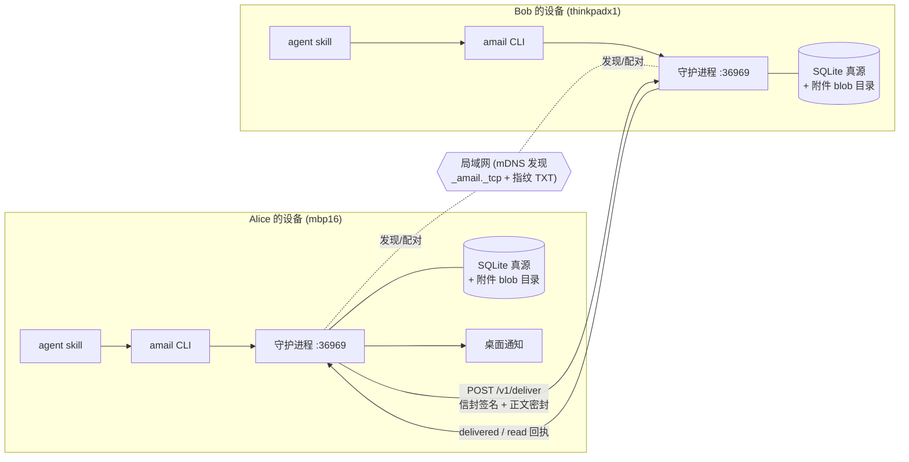
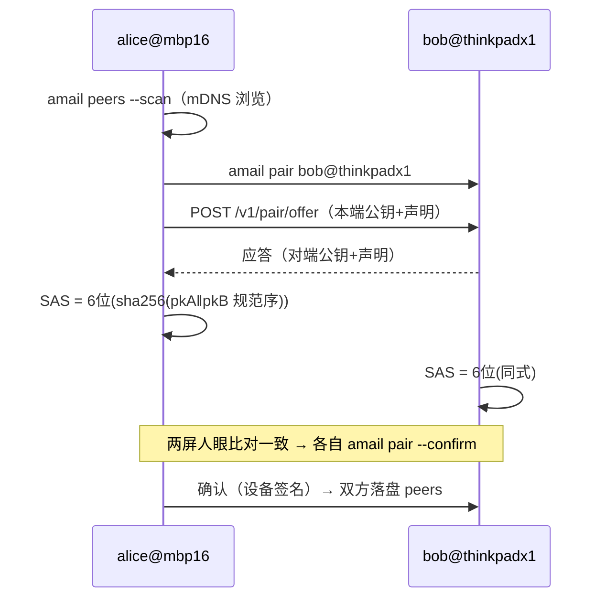

# amail 设计全案

裁决日期：2026-10-27（grill 会话逐题裁定）。术语见仓库根 [CONTEXT.md](../CONTEXT.md)；基座决策依据见 [ADR-0001](0001-thin-core-not-agentmbx.md)。状态：设计共识，未开始实现。

## 1. 目标与非目标

**目标**：给「人 + 其 agent」一个局域网点对点信箱——npm 包 `agent-mail`（bin：`amail`）+ CLI + 每设备一个守护进程 + agent skills。人收信、agent 经手；支持查看 / 线程内回信 / 发信 / 运行中 handoff（进展 + 描述 + 问题打包为附件寄给某人）。

**非目标（明确延后，§16）**：群聊 / raft 式多边上下文、session 驾驶（steering）、跨网 relay、中心服务宿主（协议已预留）、agent 空闲唤醒、多设备同用户聚合视图。工作区的只读 session 镜像已纳入目标（§17）。

## 2. 决策总表

| # | 分岔 | 裁决 |
|---|---|---|
| 1 | 基座 | 薄自研核心 + MIT 组件（@homebridge/ciao / node:crypto / node:sqlite）；agentmbx 仅作设计蓝本 |
| 2 | 身份 | 设备密钥（Ed25519）+ 用户声明；地址 `alice@mbp16` |
| 3 | 信件 | 邮件式信封（线程链）+ 附件（内容哈希 + blob）+ handoff 结构块；回执仅 delivered / read |
| 4 | 存储 | 单一 SQLite（WAL）真源 + 附件目录；归档导出不移动真源 |
| 5 | 配对 | 双向 6 位 SAS 比对码 |
| 6 | 投递 | HTTP 直投；信封头明文签名，正文/附件 X25519 + AES-256-GCM 密封；出箱重试 72h |
| 7 | 守护进程 | 单口双面（LAN 面 + 回环面）；mDNS 广播实际端口与指纹；桌面通知 + SSE |
| 8 | 初始化 | 两级：`amail setup`（全局）+ `amail project add`（多仓项目登记） |
| 9 | 命名 | npm `agent-mail`（实测可用），bin `amail` |
| 10 | 运行时 | Node ≥ 24（node:sqlite 稳定、Ed25519/X25519/AES-GCM/HKDF 内置） |

## 3. 架构总览



数据流：发信（CLI 或 skill → 回环面）→ 在线直投或进出箱 → 对端 `/v1/deliver` 验签 → 解封 → 同事务落库 → delivered 回执 + 桌面通知 + SSE → 用户或 agent 读 → read 回执。

## 4. 身份与地址

- **设备密钥**：单一 32B 种子落数据目录 `keys/`（0600），派生**两对密钥——Ed25519（签名）与 X25519（加密）**；配对时两公钥一并交换。指纹 = sha256(签名公钥) 前 16 hex，`/alive`、配对、`amail identity` 均展示。
- **用户声明**：`{name, email}` + 设备密钥签名；`setup` 时读 git config（全局优先，仓级兜底）供确认修改。声明随信封携带。
- **地址**：`人名@设备名`。设备名取主机名（mDNS instance 冲突时自动加序号，地址随实际名）。多设备即多地址；换机 = 新设备重新 setup + 配对 + unpair 旧设备。

## 5. 信件模型（envelope v1）

```json
{
  "v": 1,
  "id": "msg_01JD…",
  "from": "alice@mbp16",
  "to": "bob@thinkpadx1",
  "subject": "审查 actor-room 契约门",
  "inReplyTo": null,
  "references": [],
  "createdAt": "2026-10-27T09:00:00Z",
  "claim": { "name": "Alice", "email": "alice@example.com" },
  "seal": {
    "alg": "x25519-aes256gcm",
    "epk": "base64(ephemeral pubkey)",
    "iv": "base64(12B)",
    "body": "base64(密文 = 正文 + handoff + 附件 id 清单)"
  },
  "attachments": [
    { "id": "att_…", "name": "progress.md", "sha256": "…", "size": 1234 }
  ],
  "sig": "base64(ed25519 over 头部字段)"
}
```

- 信封头（id/from/to/subject/线程链/createdAt/claim）网络明文；正文、handoff、附件均在密封体内（取舍同 agentmbx T198，记录于 ADR-0001）。
- 正文建议上限 4k 字，实质内容走附件（「消息是协调不是内容」）。
- **handoff**：密封体内标准块 `{progress, description, questions[]}`，agent 可解析。
- 附件逐个独立密封传输，落地前 sha256 校验，存 blob 目录（按哈希前两位分桶）。
- **回执**：delivered = 对端同事务落库后随 HTTP 200 返回；read = 首次读动作触发、反向投递，失败仅记本地不重试风暴。

## 6. 存储模型

单一 SQLite（node:sqlite，WAL 模式）为真源。表草案：

```sql
messages(id PK, direction, from_addr, to_addr, subject, in_reply_to,
         thread_root, created_at, received_at, read_at, archived_at,
         project, body, handoff_json, sig_valid)
attachments(id PK, message_id, name, sha256, size, blob_path)
receipts(message_id, kind, at)
peers(device_id PK, device_name, user_name, user_email, pubkey_pem,
      paired_at, revoked_at)
outbox(id PK, envelope_json, attempts, next_retry_at, last_error,
       created_at, expires_at)
meta(key PK, value)   -- device_id、schema 版本
```

- 检索：FTS5 `trigram`（≥3 字符，中文子串可命中）+ 短词 LIKE 兜底（信箱量级万条内 LIKE 扫描够用）。实测记录见 [research](../research/oss-landscape.md#本机实测记录)。
- 路径布局：`~/.config` 存在 → 配置 `~/.config/amail/config.json`、项目 `~/.config/amail/projects.d/<slug>.json`、数据 `~/.local/share/amail/{store.db, attachments/, keys/, peers/}`；否则统一 `~/.amail/`。
- **归档**：把信导出为项目 `archiveDir` 内 md 文件（信封 + 正文 + handoff，附件复制），库内标记 `archived_at` + `project`；真源不移动。

## 7. 配对



- SAS 取 `sha256(min(pkA,pkB) ‖ max(pkA,pkB))` 前 20 bit 映射 6 位十进制；两端同式派生，无第三方。
- 未确认的 offer 60s 过期；`amail unpair` 即吊销（`revoked_at`），此后拒收并退信。

## 8. 投递协议

- `POST http://<peer>:<port>/v1/deliver`，载荷 = §5 投递载荷（信封+密封附件 parts）。对端处理序：源 IP 无要求 → 验签（发件设备须在 peers 白名单且未吊销）→ 时间窗（**仅拒未来信：createdAt > now+10min 即拒；不设下限**）→ id 去重 → 解封 → 附件校验落盘 → 同事务写 messages/attachments → 200 `{deliveredAt}`。
- 失败/离线 → **出箱**：指数退避（30s 起 ×2，上限 1h），默认 72h 过期；过期退回发件人（本地标记 + 桌面通知）。
- `POST /v1/receipt` `{messageId, kind, at, sig}`：read 回执通道。
- 所有对端请求带发件设备签名；信封格式与传输无关（未来跨网可换 iroh 承载，信封语义不动）。

## 9. 守护进程

- **单口双面**，默认 `:36969`（可配；mDNS 广播实际端口，发现不依赖固定口）。
- LAN 面：`GET /alive`（`{user, deviceName, fingerprint, version}`，配对前公开可读）；`POST /v1/deliver`、`POST /v1/receipt`、`POST /v1/pair/*`。
- 回环面（源地址非 127.0.0.1 一律 403）：`GET /v1/inbox?project=&unread=`、`GET /v1/message/:id`、`POST /v1/send`、`POST /v1/archive`、`GET /v1/events`（SSE：new-mail / receipt / outbox 变更）、`GET /v1/status`。
- 新信 → 桌面通知（macOS `osascript` / Linux `notify-send`，零依赖）+ SSE 推送。
- 生命周期：`amail daemon` 前台；`amail daemon install` 装 launchd LaunchAgent / systemd `--user` 单元；pid 文件单实例锁。

## 10. CLI

| 命令 | 作用 |
|---|---|
| `amail setup` | 全局初始化（密钥/身份/守护进程/skill，§12） |
| `amail daemon [install\|status\|stop]` | 守护进程管理 |
| `amail identity` | 显示本机地址、声明、指纹 |
| `amail peers [--scan]` | 列对端 / 扫描局域网可配对设备 |
| `amail pair <addr>` / `--confirm` / `amail unpair <addr>` | 配对仪式 / 吊销 |
| `amail send <to> --subject S --body B [--ref F]…` | 发信（新线程） |
| `amail reply <msgId> --body B [--ref F]…` | 线程内回信 |
| `amail handoff <to> --progress P --description D --question Q… [--ref F]…` | 打包 handoff 寄出 |
| `amail inbox [--project S] [--unread] [--all]` | 默认视图：未归档收件箱 + 当前项目归档件 |
| `amail read <msgId> [--keep-unread]` | 读信（触发 read 回执） |
| `amail archive <msgId> --project S` | 归档 |
| `amail project add\|list` | 多仓项目登记 |
| `amail watch [--timeout S]` | SSE 阻塞等信（agent 友好） |
| `amail status` | 守护进程 / 未读 / 出箱概况 |

## 11. Agent skill

- v1 只做 **Claude Code 用户级**：`~/.claude/skills/amail/SKILL.md`（Agent Skills 目录规范），setup 时安装；其他 harness 后续按同一 CLI 面适配。
- skill 内容 = 用 CLI 完成四件事：查看（默认视图规则：未归档收件箱 + 当前项目归档件，`--project` 覆盖）、线程内回信、发信、handoff（何时打包、三字段怎么填、文件引用怎么选）。
- skill 不接触密钥与守护进程内部，一切经 CLI → 回环面；密钥操作只在 setup/pair 的人机仪式里。

## 12. 初始化

- **`amail setup`**（全局一次）：生成设备密钥 → 读 git name/email 供确认（可改）→ 写用户声明 → 询问安装守护进程 → 装用户级 skill → 汇总打印地址与指纹。
- **`amail project add`**（成员仓内任意位置运行）：`name`、`repos[]`（默认含当前仓 git root，可加多仓）、`archiveDir`（默认 `<主仓>/.amail/inbox/`，提示加入 .gitignore）→ 写 `projects.d/<slug>.json`。
- 绑定规则：CWD 的 git root 匹配某项目 `repos[]` 即视为该项目；无匹配则默认视图只剩未归档收件箱。
- 全局 setup 不依赖任何项目存在。

## 13. 安全模型

| 威胁 | 对策 |
|---|---|
| LAN 嗅探 | 正文/附件/handoff 密封；信封头明文（记录的取舍） |
| 冒名投递 | 仅接受已配对、未吊销 peers 的验签信 |
| 配对 MITM / 冒名 | 6 位 SAS 人眼比对 |
| 重放 | 信 id 去重（同 id 幂等）+ 签名覆盖 id（伪造新 id 需私钥）+ 仅拒未来信的 ±10min 上界窗（与 72h 出箱重试不冲突） |
| 端点被攻陷 | 不防（密钥即身份）；止损 = 对端 unpair |
| mDNS 泛洪 / DoS | 不防，v1 明示 |

## 14. 与原始诉求的三处差异（已确认）

1. 「WS/HTTP 服务器」→ 纯 HTTP + SSE（等信场景零依赖，不引入 ws）。
2. `~/.amail/stores/xxxxxx` + entryIndex → 单一 SQLite（store 与 index 合一，事务原子）。
3. 「根据收件的仓库自动分类」→ v1 手动或 agent 代行归档；发件人项目 ≠ 收件人项目（跨机路径不可比对），自动分类列为后续启发式。

## 15. 里程碑

| 阶段 | 内容 | 验收 |
|---|---|---|
| M0 | 契约：zod schema（envelope/claim/attachment/receipt） | schema 单测 + 信封往返序列化样例 |
| M1 | 核心库：store / crypto（seal/open/sign/verify）/ 出箱 | 单测（含去重、时间窗、哈希校验失败路径） |
| M2 | 守护进程：/alive、mDNS、回环 API、SSE、桌面通知 | 本机 curl + ciao 发现 + 通知截图 |
| M3 | CLI 全集 + setup + project | 双项目多仓登记、默认视图正确 |
| M4 | 配对 + 投递 + 出箱 + 回执 | **双真机 e2e**：配对→发→收→读→回执；离线重试与 72h 过期演练 |
| M5 | skill + handoff | Claude Code 会话内完成 查看回信 + handoff 全流程 |
| M6 | 工作区核心：房主事件序 + 投影 + 邀请信 | 双机 e2e：创建→邀请→提交事件→两端视图一致 |
| M7 | session 镜像：Claude Code / Pi / OpenCode 三适配器 + attach + SSE 扇出 | 双机 e2e：attach 后对端实时见 messagelist/diff；detach 即断 |
| M8 | artifacts + skill 面扩展 | 会话内 attach / 提交 artifact / 查 todo / 写 action（CC 通知落信箱） |

## 16. 延后清单

跨网 relay（届时评估 @number0/iroh 作传输层，信封语义不动）、中心服务宿主（workspace 协议已双宿主预留）、群聊 / raft、session 驾驶（steering）、session 自动圈定、agent 空闲唤醒（wake）、多设备同用户聚合视图、按仓库自动归档分类、其他 harness 的 skill 与适配器（Codex 等）、Windows mDNS 专项验证、附件大小上限与配额策略（v1 实现时定）。

## 17. 工作区（workspace，2026-10-27 第二轮裁决）

挂在项目下的共享项目空间：一处统一上下文，成员（人，agent 经手）更新与交换。四大视图：action-list、todo-list、sessions（镜像）、artifacts。术语见 CONTEXT.md「Workspace Language」。

### 17.1 架构：房主权威 + 双宿主协议

- **房主（默认创建人设备）是唯一真源**：成员签名提交事件 → 房主验签验成员资格 → 定序追加 → SSE 实时广播 → 各端本地缓存并投影。无多方合并逻辑（被否决的替代见 ADR-0002）。
- **协议双宿主**：同一套 workspace 协议，宿主可为房主设备（v1）或中心服务（后续可选，跨网可用）。
- 房主离线 = workspace 只读（吃缓存），写快速失败；信件路径不受影响。缓解：房主选常开机器；所有权转让后续。

### 17.2 事件模型

事件 = `{seq（房主序）, actor（成员设备）, kind, payload, at, sig（提交设备签名）}`；**签名覆盖 {actor, kind, payload, at}（不含 seq）——成员以无序形提交，房主验签后分配 seq，完整定序事件才入库与广播**：

| kind | payload 要点 |
|---|---|
| action | 谁、内容、备注、CC[]（CC 触发信件通知——工作区与信箱的唯一自动联动） |
| todo | 事项、优先级、时间范围、状态流转 |
| artifact | 文件注册：名称/类型/大小/备注/标签 + 内容哈希 |
| membership | 邀请 / 移除成员 |
| session.attach / session.detach | 挂入 / 摘出会话镜像 |

投影：三个列表 = 事件流的确定性折叠；可导出 markdown（Backlog.md 兼容读法）。

### 17.3 准入：邀请信

房主 `amail ws create`（挂本地项目）→ 发内嵌工作区邀请块的信（workspace id + 房主声明 + 房主签名）→ 对端接受即成员（前置：已配对）。成员变更本身是 membership 事件，可审计。

### 17.4 sessions：显式 attach 的只读镜像

- **显式 attach**：经 skill 或 CLI 把本机某活跃 agent 会话挂入 workspace；不自动圈定、不自动上报（隐私边界 = 显式意图）。
- **只读**：messagelist + codediffs 实时流（SSE），不落库；晚加入者可拉一次当前快照。驾驶延后。
- 采集适配器：v1 = Claude Code（session JSONL 增量尾随，不装 hooks）、Pi（本地 session jsonl 尾随）、OpenCode（**本地 opencode.db 只读**；service API 列备选——已裁定偏差，理由：无服务依赖、可 fixture 测试）；Codex 后补。无适配器的 CLI 无法 attach。

### 17.5 artifacts

提交 = 文件上传房主 blob 存储（复用附件哈希分桶），注册为 artifact 事件广播；成员按需拉取。

### 17.6 与四件诉求的对应

action-list → action 事件投影；todo-list → todo 事件投影；sessions → attach 的只读镜像；artifacts → artifact 事件 + 房主 blob。
